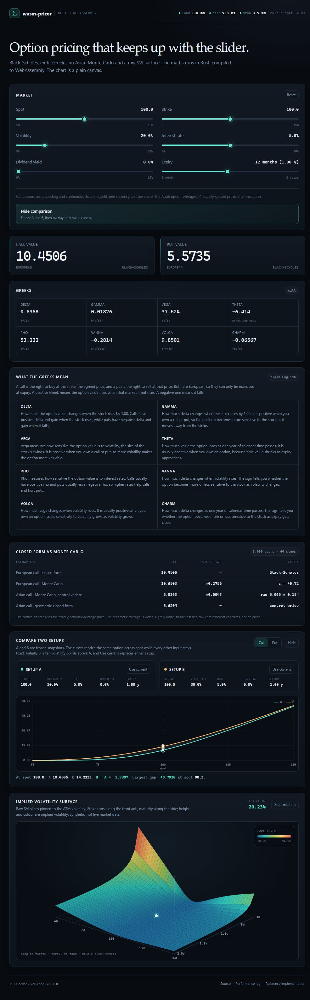

# wasm-pricer

[](https://github.com/IkerAbad/wasm-pricer/actions/workflows/ci.yml)

A static option-pricing page whose calculations run in Rust, compiled to
WebAssembly. Move a slider and the page reprices a European option, updates
eight Greeks, estimates an arithmetic-average Asian option by Monte Carlo and
redraws an SVI volatility surface on a plain canvas.

**Live demo:** https://ikerabad.github.io/wasm-pricer/

No backend, no accounts, no market data feed. The only dependencies are
`wasm-bindgen` and `libm`; the chart is hand-written canvas code.



## What is in the box

- Black-Scholes price and Greeks for European calls and puts, with a continuous
  dividend yield in the core and `q = 0` in the UI.
- Arithmetic-average Asian option by Monte Carlo over full price paths, with a
  raw estimate and a control-variate estimate.
- Exact discrete geometric-average Asian price, used as the control variate.
- Raw SVI total-variance slices pinned to the ATM volatility, sampled on a
  49 × 20 strike/maturity grid.
- Canvas 2D 3D renderer: drag to rotate, scroll to zoom, keyboard support,
  auto-rotation (disabled when the OS asks for reduced motion).
- Live measurements: load time, WASM recalculation time and canvas draw time.
- Reference tests in Rust and Node against
  [options-pricer](https://github.com/IkerAbad/options-pricer).

## Layout

```text
src/
  black_scholes.rs   closed-form prices and Greeks
  monte_carlo.rs     Asian simulation, geometric closed form, control variate
  prng.rs            xoshiro256** and a polar Box-Muller normal sampler
  svi.rs             raw SVI slices and the surface grid
  lib.rs             wasm-bindgen exports
web/
  index.html         static page
  app.js             UI, measurements and canvas renderer
  style.css          layout and styles
  pkg/               generated by wasm-pack (ignored by git)
tests/
  reference.rs       Rust reference tests
  node/              Node reference tests
  reference.json     values generated by scripts/reference.py
scripts/
  reference.py       regenerates reference.json with options-pricer
```

## Conventions

- Spot, strike and prices are in currency units per share.
- Rates, volatility and dividend yield are annualised. Expiry is in years.
- Rates are continuously compounded.
- Vega is per unit of volatility (`0.20`, not `20`). Rho is per unit of rate.
- Theta is per calendar year. Charm is minus the derivative of delta with
  respect to time to expiry.
- Paths follow the exact lognormal transition, not an Euler discretisation.
  Monitoring is discrete at the same steps used to build the path.
- The Asian average excludes spot and uses the 64 prices at
  `t = T/64, ..., T`.
- A call is a right to buy, a put a right to sell. No early exercise.

These conventions match `options-pricer` 0.8.0 (commit `60536cc`).

## The maths

### Black-Scholes

With carry `b = r - q`:

```text
d1 = (ln(S/K) + (b + σ²/2) T) / (σ √T)
d2 = d1 - σ √T

C = S e^(-qT) Φ(d1) - K e^(-rT) Φ(d2)
P = K e^(-rT) Φ(-d2) - S e^(-qT) Φ(-d1)
```

The Greeks are the standard first and second derivatives:

```text
delta = ∂V/∂S
gamma = ∂²V/∂S²
vega  = ∂V/∂σ
theta = ∂V/∂t
rho   = ∂V/∂r
vanna = ∂²V/∂S∂σ
volga = ∂²V/∂σ²
charm = -∂delta/∂T
```

`Φ` is implemented through `erfc` from `libm`, which keeps tail accuracy.
The implementation follows the same formulas and sign conventions as
`options-pricer/src/options_pricer/black_scholes.py`, including the dividend terms.

### Asian Monte Carlo

For each path:

```text
S(t + Δ) = S(t) exp((r - q - σ²/2) Δ + σ √Δ Z),  Z ~ N(0, 1)
A = (1/n) Σ S(t_i)
payoff = max(A - K, 0)  for a call
```

The arithmetic average has no simple closed form. The discrete geometric
average does:

```text
G = (Π S(t_i))^(1/n)
μ = ln S + (r - q - σ²/2) T (n + 1) / (2n)
σ²_G = σ² T (n + 1)(2n + 1) / (6n²)
```

`G` is lognormal, so the price of an option on `G` is Black-Scholes applied to
`E[G] = exp(μ + σ²_G/2)` and `σ_G`. This is the exact closed form for the same
monitoring dates.

The arithmetic and geometric payoffs are highly correlated, so the geometric
price is used as a control variate:

```text
β = Cov(Y_arithmetic, Y_geometric) / Var(Y_geometric)
price_cv = mean(Y_arithmetic) - β (mean(Y_geometric) - price_geometric)
se_cv = std(Y_arithmetic - β Y_geometric) / √N
```

The page shows both the raw and control-variate estimates. With 3,000 paths the
control-variate standard error is around 0.004, smaller than the 0.006 standard
error of a 2,000,000-path raw estimate on the same contract. That is why the
page can meet the 16 ms budget without giving up precision.

### Volatility surface

The surface uses the raw SVI parameterisation:

```text
w(k) = a + b (ρ (k - m) + √((k - m)² + σ_svi²))
k = ln(K / F), F = S e^(rT)
σ(K, T) = √(max(w(k), ε) / T)
```

Each maturity slice keeps `b = 0.06 + 0.04√T`, `ρ = -0.35`, `m = -0.05` and
`σ_svi = 0.15`. Only `a` changes, and it is chosen so that `w(0) = σ_ATM² T`.
The ATM volatility is the slider value. The surface is therefore synthetic and
pedagogical: it shows a plausible skew and term structure, not a calibrated
market. The option itself is priced with the flat slider volatility, so it does
not read its volatility back from the surface.

Strikes run from 40 to 160 in 49 steps. Maturities run from 1 month to 2 years
in 20 steps. The marker is the current `(K, T)` point, and its height is the
surface volatility at that point.

## Validation

The reference values come from `options-pricer` 0.8.0 (commit `60536cc`). They
are stored in `tests/reference.json` and used by the Node test. The Rust test contains the
same numbers as constants, so the two suites check the same targets.

| Quantity | Reference |
|---|---:|
| European call | 10.4505835722 |
| European put | 5.5735260223 |
| Call delta | 0.6368306512 |
| Call vega | 37.5240346917 |
| Asian call, 64 steps, 2M paths | 5.8394982805 ± 0.0057127797 |
| Asian put, 64 steps, 2M paths | 3.3799822872 ± 0.0037547030 |
| Geometric Asian call | 5.6204344318 |
| Geometric Asian put | 3.4988899294 |

Tolerances:

- **Closed form:** absolute error ≤ `1e-9` against the Python values. This
  covers prices, all eight Greeks and the geometric Asian formula.
- **Monte Carlo:** the Rust and Python runs use different random streams, so a
  path-by-path comparison is impossible. The raw estimate is checked against
  the 2,000,000-path reference within **four combined standard errors**. The
  control-variate estimate is checked within **0.01 absolute**; at 3,000 paths
  the observed difference is about 0.003.
- **SVI:** the raw total-variance formula is checked against the Python function
  at a fixed point to `1e-15`, and every surface point must be finite and
  positive.

Regenerate the JSON from the options-pricer checkout:

```bash
OPTIONS_PRICER_SRC=/path/to/options-pricer/src python scripts/reference.py
```

Run it with a Python environment that can import options-pricer. The script uses
two million paths and seed 42. It is not part of CI because the Python package is
not a dependency of this repository; the generated JSON is committed.

## Performance

There are three numbers in the header:

- **load**: navigation start to the first rendered surface, including the WASM
  download, instantiation and two recalculation passes (one warm-up).
- **calc**: wall time around the four WebAssembly calls that produce the two
  quotes, the Asian estimate and the surface.
- **draw**: wall time for one canvas frame.

The 16 ms budget in the header applies to **calc**. The page turns the value
amber when a recalculation exceeds it.

On the development machine (Ryzen 9 5900X, Windows 11, Chrome 152, 1000 × 700
viewport) the page reports roughly:

| Measurement | Observed |
|---|---:|
| Load, local warm cache | 50–200 ms |
| Load, published site, cache disabled | 440–600 ms |
| Recalculation, median | 7–12 ms |
| Canvas draw | 6–11 ms |

The release WASM binary is about 33 KB. The budget is met on the calculation
path. A slider movement also triggers a canvas redraw, so a single changed
frame can approach 16 ms on this machine. The measurement chips expose both
numbers rather than hiding the split.

## Run it locally

Requirements: Rust stable with the `wasm32-unknown-unknown` target,
`wasm-pack`, and Node 24 or newer.

```bash
rustup target add wasm32-unknown-unknown
cargo install wasm-pack      # or install a release binary
npm run build                # writes web/pkg
python -m http.server 8000 -d web
```

Open `http://localhost:8000/`. The page must be served over HTTP; opening
`index.html` directly through `file://` will not load the WASM module.

Tests:

```bash
cargo test --release
npm run build:node
npm test
```

## Continuous integration

`.github/workflows/ci.yml` runs on every push and pull request:

1. `cargo fmt --check` and `cargo clippy --all-targets -- -D warnings`.
2. `cargo test --release --all-targets`.
3. Builds the Node target, runs the Node reference tests.
4. Builds the web target and uploads `web/` as the Pages artifact.

On `main`, the deploy job publishes that artifact with GitHub Pages. The
repository's Pages source must be set to **GitHub Actions**.

## Scope and limitations

- No backend, accounts, persistence or live market data.
- The volatility surface is synthetic, not calibrated, and the option is priced
  with a flat volatility. The two are deliberately separate.
- The UI fixes the dividend yield at zero. The Rust API accepts a dividend
  yield and the Rust suite has a reference test with `q = 3%`.
- Path count and seed are fixed to keep recalculation fast and the display
  stable. There is no variance-reduction option other than the geometric
  control variate.
- The renderer is a painter's-algorithm canvas renderer, not WebGL. It is meant
  to stay dependency-free and readable, not to render millions of points.

## License

MIT. Copyright (c) 2026 Iker Abad.


